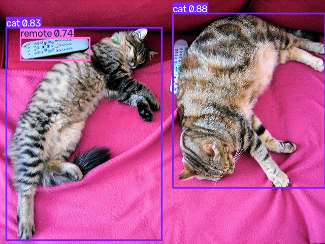

# YOLO 摄像头实时目标检测 Demo

一个基于 **OpenCV + Ultralytics YOLOv8** 的入门级视觉识别小项目：调用电脑摄像头读取实时画面，用 YOLO 预训练模型检测画面中的常见物体，在窗口中绘制检测框、类别名称和置信度，并支持一键截图。

> 本项目为感知组第二次学习任务的实践部分，只使用官方预训练权重，不涉及数据采集与模型训练。

## 1. 功能

- 调用本机摄像头（或外接摄像头），实时读取视频画面；
- 使用 `yolov8n.pt` 检测 COCO 数据集的 80 类常见物体；
- 画面中显示检测框、类别、置信度和实时 FPS；
- 按 `q` 或 `Esc` 正常退出并释放摄像头；
- 按 `s` 把当前带检测框的画面保存到 `outputs/`；
- 附带 `detect_image.py`，可对单张图片做同样的检测，方便没有摄像头时验证。

## 2. 环境要求

| 项目 | 说明 |
| --- | --- |
| 操作系统 | Windows 10/11 或 Ubuntu 20.04+（本项目在 Windows 10 上验证） |
| Python | 3.10（Conda 环境 `perception`） |
| 主要依赖 | ultralytics、opencv-python、torch、torchvision |
| 硬件 | 普通 CPU 即可运行；有 NVIDIA 显卡时速度更快 |

## 3. 创建环境与安装依赖

### 方式一：使用 Conda（推荐）

```bash
conda env create -f environment.yml
conda activate perception
```

### 方式二：使用 pip

```bash
conda create -n perception python=3.10 -y
conda activate perception
pip install -r requirements.txt
```

如需使用 GPU，请先按 [PyTorch 官网](https://pytorch.org/get-started/locally/) 的命令安装对应 CUDA 版本的 torch，再安装其余依赖。

## 4. 运行

```bash
# 实时摄像头检测（默认 0 号摄像头）
python detect_camera.py

# 指定摄像头编号和置信度阈值
python detect_camera.py --camera 1 --conf 0.4

# 没有摄像头时，用图片验证流程
python detect_image.py --source assets/sample.jpg
```

运行后窗口按键说明：

| 按键 | 作用 |
| --- | --- |
| `q` / `Esc` | 退出程序 |
| `s` | 保存当前画面到 `outputs/` |

常用参数：

| 参数 | 默认值 | 说明 |
| --- | --- | --- |
| `--camera` | `0` | 摄像头编号，外接摄像头可尝试 `1`、`2` |
| `--model` | `yolov8n.pt` | 模型权重，可换成 `yolov8s.pt`、`yolo11n.pt` 等 |
| `--conf` | `0.5` | 置信度阈值，越低检出越多、误检也越多 |
| `--width / --height` | `1280 / 720` | 摄像头采集分辨率 |

## 5. 模型权重

首次运行脚本时，Ultralytics 会自动从官方地址下载 `yolov8n.pt`（约 6 MB）到当前目录：

- 下载地址：<https://github.com/ultralytics/assets/releases>
- 也可以手动下载后放到项目根目录，或用 `--model` 指定权重路径。

权重文件体积较大且可自动获取，因此已写入 `.gitignore`，不随仓库上传。

## 6. 运行效果



在示例图片上的检测结果：两只猫（cat）与遥控器（remote）被正确框出，标签上带有类别名称与置信度。

## 7. 从摄像头画面到检测结果的流程

1. `cv2.VideoCapture` 打开摄像头设备，循环 `read()` 读取 BGR 帧；
2. 把当前帧送入 `YOLO.predict()`，模型完成预处理、前向推理与 NMS 后处理；
3. `results[0].plot()` 把检测框、类别和置信度画到帧上；
4. `cv2.imshow()` 显示结果，`cv2.waitKey()` 读取键盘事件；
5. 按 `q` / `Esc` 跳出循环，`release()` 释放摄像头、`destroyAllWindows()` 关闭窗口。

## 8. 常见问题

| 问题 | 原因 | 解决办法 |
| --- | --- | --- |
| `Cannot open camera 0` | 摄像头被占用、驱动异常或编号不对 | 关闭其他调用摄像头的软件；在设备管理器中检查驱动；尝试 `--camera 1` |
| 画面很卡、FPS 很低 | CPU 推理、分辨率过高 | 换更小的模型（`yolov8n.pt`）、降低分辨率、有 N 卡时安装 CUDA 版 torch |
| 窗口中文显示为方块 | OpenCV 自带字体不支持中文 | 本项目使用模型自带的英文类别名，避免该问题 |
| 首次运行卡在下载权重 | 网络访问 GitHub 较慢 | 手动下载 `yolov8n.pt` 放到项目根目录 |
| `ModuleNotFoundError: ultralytics` | 没有激活环境或未安装依赖 | `conda activate perception` 后重新 `pip install -r requirements.txt` |

## 9. 目录结构

```
yolo_camera_demo/
├── detect_camera.py      # 摄像头实时检测
├── detect_image.py       # 单张图片检测
├── requirements.txt      # pip 依赖
├── environment.yml       # conda 环境
├── .gitignore
├── assets/
│   ├── sample.jpg        # 测试图片
│   └── demo_result.jpg   # 检测结果
└── outputs/              # 运行时截图（不上传）
```

## 10. 说明

- 只使用 COCO 预训练模型，模型能识别的类别有限，未见过的物体可能检测不到；
- 摄像头画面仅在本机处理，不上传任何服务器；
- 本项目代码与文档在 AI 辅助下完成，已在本机实际运行验证。
